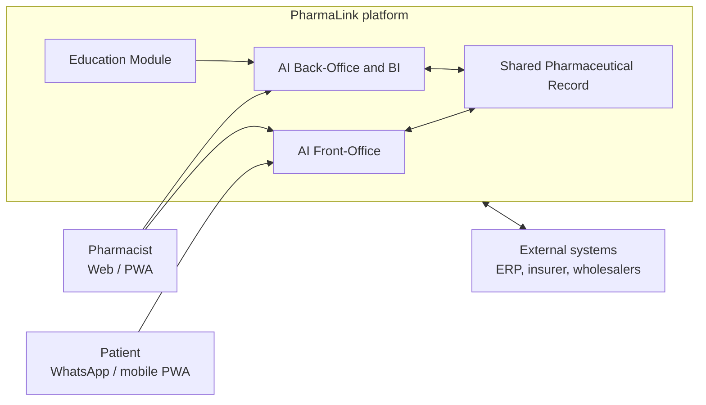

# PharmaLink

**An AI-powered SaaS platform for pharmacies: decision support, back-office automation and a shared patient record, designed to keep the pharmacist in control.**

Built for PharmaLink, a Tunisian digital-health startup.

[Demo video](https://youtu.be/Z31903lbKTA) · [Company page](https://www.linkedin.com/company/pharmalink-saas/) · [Portfolio](https://bouzidimariam.github.io/projects.html)

> **About this repository.** PharmaLink is a commercial product. This repository documents the engineering behind it: the problem, the architecture, the design decisions and the roadmap. It deliberately contains no production code, no real data and no proprietary model details. See [Scope of this repository](#scope-of-this-repository).

---

## Why PharmaLink

Pharmacies in Tunisia still run on tools built for invoicing and basic stock tracking. In practice that means:

- Prescriptions are checked by hand, with no systematic safety net for interactions or duplicates.
- Stock-outs and over-stocking are common, because purchasing is driven by habit rather than data.
- Patient history is fragmented across pharmacies and practitioners.
- Existing software is either too basic or imported, expensive and poorly adapted to local rules.

PharmaLink brings these pieces into one platform and uses AI only where it helps the pharmacist decide faster and more safely.

## What it does

PharmaLink is organised as four interconnected modules:

| Module | Purpose | Highlights |
|---|---|---|
| **AI Front-Office** | Assist dispensing and patient communication | Interaction and contraindication alerts, prescription scanning (OCR + NLP, Phase 2), bilingual assistant (French / Tunisian Arabic), WhatsApp Business channel |
| **AI Back-Office & BI** | Run the pharmacy with data | Stock monitoring, predictive reordering, expiry and lot tracking, live dashboards, anomaly detection |
| **Shared Pharmaceutical Record (DPP)** | One consent-based patient medication history | Role-based access, patient consent, full audit trail |
| **Education Module** | Continuing professional training | Courses, quizzes, certificates, learning analytics |

A guiding rule runs through all of them: **the AI proposes, the pharmacist decides.**

## My role

I am the **Data Lead and software architect** on PharmaLink. I own the system design and architecture: how the modules fit together, how data flows between them, where AI belongs in the workflow, and how security and privacy constraints shape the platform. I did this work with the team and in close collaboration with the founder and product owner, Dr. Omar Hafoudhi.

## Architecture at a glance

Modules talk through secured REST APIs and an internal event bus, run multi-tenant on shared infrastructure with isolated pharmacy data, and combine local (edge) and cloud processing. The full picture is in [docs/architecture.md](docs/architecture.md).

## Key engineering decisions

- **Human in the loop.** AI outputs are decision support, never automatic dispensing. Major risks block and escalate.
- **Modular, service-oriented design** so new modules and pharmacies are added without touching the core.
- **Hybrid edge + cloud AI** for low latency, offline resilience and less sensitive data leaving the pharmacy.
- **Privacy by design.** Data minimisation, pseudonymisation, explicit patient consent, encrypted storage and transport.
- **Auditability.** Critical actions (record access, dispensing, deletion) are logged in a tamper-evident trail.
- **Local fit.** Bilingual interface and workflows adapted to Tunisian regulation and practice.

The reasoning and the costs of each choice are in [docs/constraints-and-tradeoffs.md](docs/constraints-and-tradeoffs.md).

## Target technology stack

| Layer | Technologies |
|---|---|
| Front-end | Responsive web app and mobile PWA, accessibility aligned with WCAG 2.1 |
| Back-end | Service-oriented / microservice architecture, REST APIs |
| AI & analytics | OCR, NLP, time-series forecasting, recommendation, conversational AI |
| Data | PostgreSQL, MongoDB, Redis cache |
| Security | OAuth2, JWT, role-based access control, AES-256 at rest, TLS 1.3 |
| Infrastructure | Docker, Kubernetes, hybrid edge + low-carbon cloud |
| Delivery & monitoring | GitLab CI/CD, Prometheus, Grafana, ELK stack |

## Documentation

| Document | What it covers |
|---|---|
| [Architecture](docs/architecture.md) | System context, layers, modules, key flows, security and deployment |
| [AI pipeline](docs/ai-pipeline.md) | How AI assists dispensing, stock and conversation, and how it is evaluated |
| [Constraints and trade-offs](docs/constraints-and-tradeoffs.md) | The constraints we design under and the decisions they led to |
| [Roadmap](docs/roadmap.md) | Phases, near-term engineering priorities, known limitations |

## Recognition

- **Tunisia Global Forum 2026**: AI Business & Startups Awards, Early Stage category
- **BIGTECH Africa**, Tunis, October 2026: PharmaLink showcased

## Scope of this repository

**Included:** architecture and design documentation, diagrams, engineering decisions, roadmap.

**Not included, by design:** production source code, customer or patient data (real or derived), model weights, prompts, thresholds, training data sources, third-party reference databases, credentials and partner agreements.

PharmaLink supports pharmacy professionals; it does not replace their judgement and is not a substitute for professional medical or pharmaceutical advice.

## Team

- **Dr. Omar Hafoudhi**: Pharmacist, Founder & CEO, Product Owner
- **Mariam Bouzidi**: Data Lead, software architecture and data science
