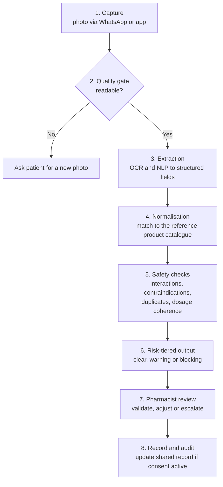

# AI Pipeline

This document explains how AI is used in PharmaLink, the principles that constrain it, and how we evaluate it. It is written at design level. Implementation details are intentionally left out (see [What is not covered](#7-what-is-not-covered)).

---

> **Phasing.** Prescription capture and OCR extraction (stages 1 to 3 of the prescription pipeline) are delivered in Phase 2. Before that, the pharmacist enters the prescription and the later stages apply to it. See the [roadmap](roadmap.md).

## 1. Principles

1. **Assistive, not autonomous.** AI prepares and flags; the pharmacist validates. No dispensing decision is taken by a model alone.
2. **Conservative by default.** When the system is uncertain, it says so, lowers its confidence signalling and asks for human review rather than guessing.
3. **Scoped.** Every AI component has a defined job and a defined boundary. Prescription-only requests are always routed to a pharmacist.
4. **Privacy-preserving.** Models are developed on minimised, pseudonymised data. No directly identifying patient data is used for training or analytics.
5. **Explainable to a professional.** Alerts show what was found and why, so the pharmacist can check them quickly.
6. **Measured.** Each component has evaluation criteria and is monitored after deployment.

## 2. Where AI is used

| Area | Component | Role |
|---|---|---|
| Front-Office | Prescription understanding (OCR + NLP) | Turn a photo into a structured prescription |
| Front-Office | Safety checks | Flag interactions, contraindications, duplicates and incoherent dosing |
| Front-Office | Conversational assistant | Answer routine patient questions in French and Tunisian Arabic |
| Back-Office | Demand forecasting | Anticipate needs from sales history, seasonality and trends |
| Back-Office | Anomaly detection | Surface unusual consumption, stock or billing patterns |
| Education | Recommendation | Suggest training relevant to a user's gaps |

## 3. Prescription pipeline

| Stage | Purpose | Failure behaviour |
|---|---|---|
| Quality gate | Reject images too poor to read reliably | Automatic request for a new photo |
| Extraction | Read medication names, strengths, posology, duration | Low-confidence fields are highlighted for manual check |
| Normalisation | Resolve the extracted text to a known product | Unresolved items are flagged, never silently guessed |
| Safety checks | Detect risks across the full treatment | Major interaction blocks dispensing and prompts physician contact |
| Output | Present findings by severity | Alerts are ranked to limit alert fatigue |
| Review | Human decision | The pharmacist can always override or escalate, and the action is logged |
| Record | Keep history accurate | Updated only with active patient consent |

Out-of-stock items trigger a search for alternatives, proposed to the pharmacist rather than substituted automatically.

## 4. Conversational assistant

- **Scope:** availability, opening hours, on-call pharmacies, reservations, reminders and general information.
- **Boundaries:** prescription-only or regulated medication requests are redirected to a human with a clear "pharmacist intervention required" response. Situations that need medical orientation are escalated, not answered.
- **Languages:** French and Tunisian Arabic, the latter being a low-resource dialect that needs dedicated handling.
- **Traceability:** conversations are logged for audit and quality review.

## 5. Back-office analytics

- **Demand forecasting** works from sales history, seasonality and consumption trends, with epidemiological signals considered as the platform matures. It drives suggested purchase orders, which the pharmacist approves or adjusts.
- **Anomaly detection** highlights unusual stock movements and billing inconsistencies, and can trigger an automatic quality audit.
- **Reliability signalling:** when input data is incomplete, the output is explicitly marked as unreliable instead of presented with false confidence.

## 6. Evaluation and monitoring

We evaluate against what matters in practice, not just model accuracy.

| Dimension | Examples of what we assess |
|---|---|
| **Extraction quality** | Field-level correctness on prescriptions of varied quality and handwriting |
| **Alert quality** | Whether real risks are caught (recall) and whether alerts are worth reading (precision) |
| **Workflow impact** | Time to dispense, pharmacist override rate, alert fatigue |
| **Forecast quality** | Accuracy of stock predictions and effect on shortages and over-stock |
| **Language quality** | Correctness and safety of assistant replies in French and Tunisian Arabic |
| **Operational health** | Latency, availability, drift of inputs and outputs over time |

Practices: validation with practising pharmacists, versioned models and datasets, regression tests before each release, and continuous monitoring in production.

**Data and bias.** Data quality and availability are a known limitation in the Tunisian context. Models are first tuned on contextual data and improved progressively as aggregated, anonymised data grows, with attention to bias and drift.

## 7. What is not covered

To protect the product and its partners, this document does not describe:

- Specific models, architectures, libraries or hyper-parameters
- Prompts and system instructions
- Decision thresholds and severity rules
- Training, evaluation and reference datasets and their sources
- Third-party medical reference databases and how they are integrated
- Quantitative performance figures from internal testing

Happy to discuss the approach in more depth in an interview or research setting, within the limits of confidentiality.

## 8. Related documents

- [Architecture](architecture.md)
- [Constraints and trade-offs](constraints-and-tradeoffs.md)
- [Roadmap](roadmap.md)
