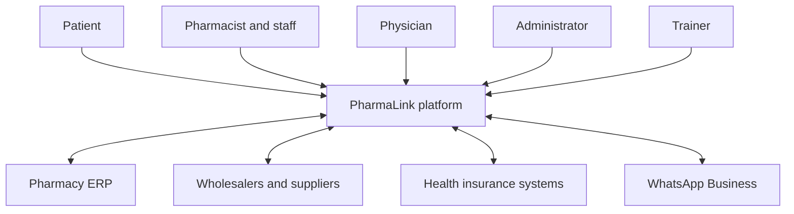
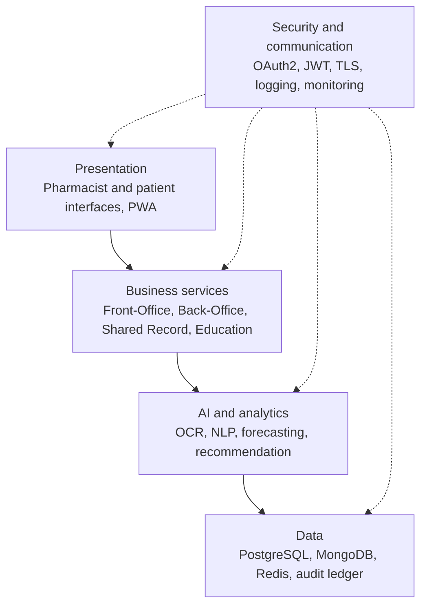
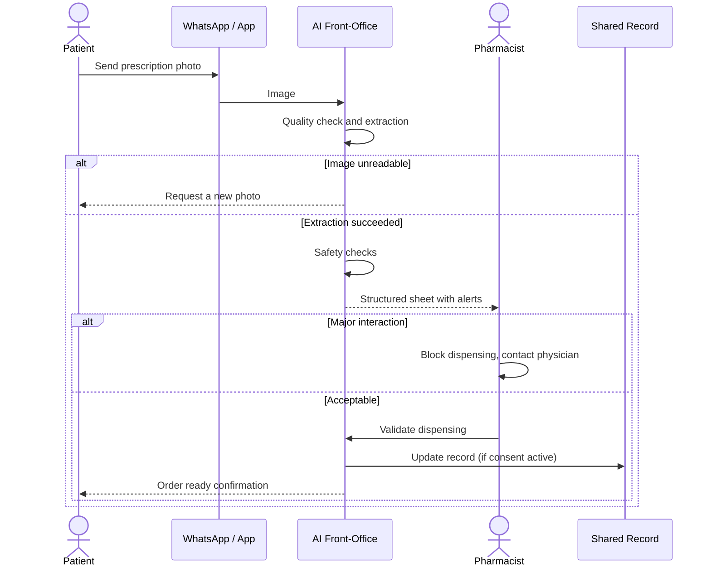
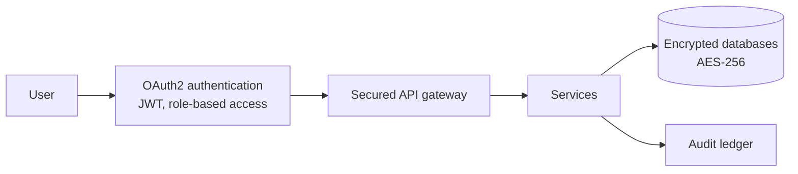
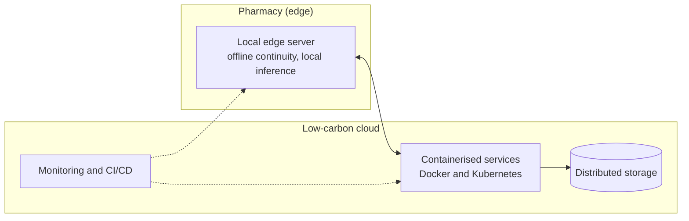

# PharmaLink Architecture

This document describes the architecture of PharmaLink: what the system must achieve, how it is structured, how the main flows work, and how security and deployment are handled.

> **Status convention.** This is the target architecture. Items are tagged by delivery phase (**Phase 1 (MVP)**, **Phase 2**, **Phase 3**); see the [roadmap](roadmap.md).

---

## 1. Goals and architectural drivers

The architecture is shaped by what the pharmacy domain demands:

| Driver | What it means for the design |
|---|---|
| **Patient safety** | AI is advisory. Every dispensing decision stays with the pharmacist, and major risks block and escalate. |
| **Sensitive health data** | Minimisation, pseudonymisation, encryption, consent and auditability are built in from the start. |
| **Heterogeneous pharmacies** | Pharmacies differ in size, digital maturity and connectivity. Modules must be usable independently. |
| **Unreliable connectivity** | Core workflows must keep working when the network does not. |
| **Interoperability** | The platform must connect to ERPs, wholesalers and, over time, national health systems. |
| **Growth** | Going from a few pilot pharmacies to a national network must not require re-architecture. |
| **Sustainability** | Efficient code, caching and low-carbon hosting are design criteria, not afterthoughts. |

## 2. Architectural principles

1. **Modular, service-oriented.** Each business module is independent and communicates over secured REST APIs and an internal event bus.
2. **Multi-tenant SaaS.** Many pharmacies share infrastructure while their data stays logically isolated.
3. **Interoperability first.** Standard interfaces (REST/JSON, OAuth2, FHIR-aligned data models for clinical data).
4. **Horizontal scalability.** Adding a pharmacy or a module does not change the core.
5. **Privacy and security by design.** Encryption, role-based access and audit logging are platform capabilities used by every module.
6. **Edge where it helps, cloud where it scales.** Latency-sensitive and offline-critical work runs locally; heavy analytics run in the cloud.

## 3. System context

| Actor | Main interactions |
|---|---|
| Pharmacist | Validates dispensing, manages stock and orders, consults the shared record, follows training |
| Patient | Sends prescriptions, asks questions, receives reminders, grants or withdraws consent |
| Physician | Consults medication history (with patient consent), coordinates with the pharmacist |
| Administrator | Manages users, roles, modules, compliance and audit reports |
| Trainer | Publishes courses, tracks learners, issues certificates |

## 4. Layered view

Security and communication is a cross-cutting layer: every call between layers is authenticated, authorised and logged.

## 5. Modules

### 5.1 AI Front-Office (Phase 1, prescription OCR in Phase 2)
Interface between the pharmacist and the patient.

- Prescription digitisation (OCR + NLP) and structured extraction (Phase 2)
- Interaction, contraindication and duplicate detection
- Suggestion of alternatives (generics, forms, dosages)
- Bilingual conversational assistant (French / Tunisian Arabic) and WhatsApp Business channel
- Reminders and refill tracking
- Accessibility: high contrast, dark mode, screen-reader compatibility, voice assistance

### 5.2 AI Back-Office and BI (Phase 1, predictive features Phase 2)
Operational and decision-making core.

- Stock monitoring, lot and expiry traceability, shortage alerts
- Purchase-order generation and supplier ordering
- Finance support: invoicing, accounting integration, reimbursement estimation (Phase 2, with insurer data)
- Real-time dashboards (sales, margins, stock rotation)
- Demand forecasting and anomaly detection (Phase 2)

### 5.3 Shared Pharmaceutical Record, DPP (Phase 1)
One consent-based medication history across pharmacies and practitioners.

- Patient profile: allergies, conditions, current treatments
- Chronological dispensing history across connected pharmacies
- Access by role (pharmacist, physician, administrator) and by patient consent
- Complete audit trail of reads and writes

### 5.4 Education Module (Phase 1)
Continuing professional development inside the workflow.

- Course catalogue, micro-learning, adaptive quizzes
- Certificates and learning analytics linked to pharmacy performance
- Trainer and administrator tooling

## 6. Key flow: assisted dispensing

Photo capture and automatic extraction arrive in Phase 2. In Phase 1 the pharmacist enters the prescription, and the same safety checks and validation steps apply.

The pharmacist is the decision point in every branch. The record is updated only when patient consent is active, and every step is logged.

## 7. Data architecture

| Store | Used for |
|---|---|
| **PostgreSQL** | Transactional data: stock, orders, users, dispensing, shared-record entries |
| **MongoDB** | Flexible, document-shaped data: extracted prescription content, conversational context, learning content |
| **Redis** | Caching for responsiveness and reduced compute |
| **Audit ledger** | Append-only, tamper-evident log of critical actions |

Principles: strict tenant isolation, data minimisation (no directly identifying data is used for analytics or model improvement), and pseudonymisation wherever medical data is processed beyond care delivery. See [AI pipeline](ai-pipeline.md) for how data feeds the models.

## 8. Security and privacy architecture

- **Identity and access:** OAuth2, JWT, role-based access control; patients grant and revoke access to their record.
- **Encryption:** AES-256 for data at rest, TLS 1.3 in transit.
- **Traceability:** timestamped, tamper-evident logging of record access, dispensing and deletion.
- **Compliance by design:** aligned with GDPR principles, Tunisian data-protection requirements and health-data hosting standards.
- **Anomaly detection:** unauthorised access attempts raise administrator alerts.

## 9. Performance, scalability and deployment

| Target | Value |
|---|---|
| Availability (MVP) | 99% SLA target with automatic recovery |
| Response time | Average ≤ 2 s for 95% of requests |
| Local AI latency | < 50 ms for edge-served inference |
| Accessibility | WCAG 2.1, responsive on desktop, tablet and mobile |
| Languages | French and Tunisian Arabic |

- **Hybrid processing:** the design target is to keep most inference local for latency, privacy and resilience, and use the cloud for heavy analytics and aggregation.
- **Containers and orchestration:** Docker and Kubernetes with horizontal auto-scaling.
- **Resilience:** multi-node replication, daily incremental backups, disaster-recovery plan.
- **Delivery and observability:** GitLab CI/CD; Prometheus, Grafana and the ELK stack for metrics, dashboards and logs; proactive alerts on performance and security anomalies.
- **Green IT:** lazy loading, compression, caching, and hosting on certified low-carbon providers.

## 10. Related documents

- [AI pipeline](ai-pipeline.md)
- [Constraints and trade-offs](constraints-and-tradeoffs.md)
- [Roadmap](roadmap.md)
