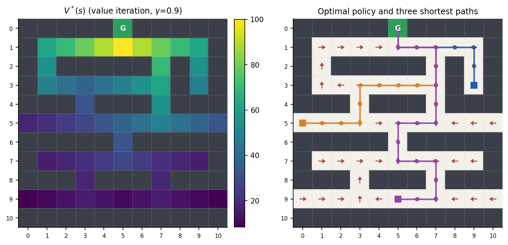
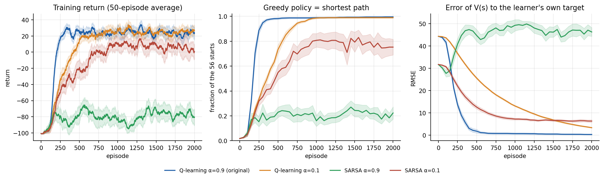
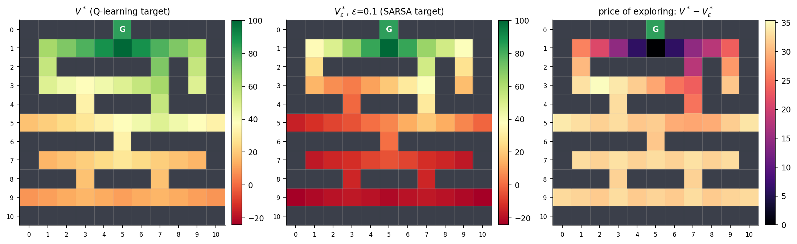

# Reinforcement Learning on a Warehouse Grid: Q-learning, SARSA and Policy Gradients

A robot must reach the packaging area of an 11×11 warehouse without hitting a shelf. The problem is small enough to be **solved exactly**, so every learning algorithm here is graded against the true optimum over many random seeds, instead of judging a single training run by eye.

<p align="center"></p>

## Key findings

All numbers are means over seeds, graded exactly from the 56 free starting squares (full tables, confidence intervals and code in the notebook).

| Method | Starts whose greedy path is a shortest path |
|---|---|
| Q-learning, α = 0.9 (original settings), 2000 episodes | **99.6 %** |
| Q-learning, α = 0.1, 2000 episodes | 98.9 % |
| SARSA, α = 0.1, 2000 episodes | 75 % |
| SARSA, α = 0.9, 2000 episodes | 22 % |
| REINFORCE with baseline, 10 000 episodes | 90 % |
| REINFORCE without baseline, 10 000 episodes | 64 % |

1. **Q-learning solves the deterministic warehouse** quickly and for almost every (α, ε, γ) tried.
2. **SARSA is much more fragile, and the exact solution explains why.** Its target (the best policy *that keeps exploring*) is itself optimal, but with ε = 0.1 an exploring agent is expected to crash before reaching the goal on 28 of 56 squares. Action values then differ by only a few units, and rare −100 samples add noise. SARSA's failures are loops, not crashes.
3. **The policy converges long before the value function does.**
4. **Policy gradient works but is sample-hungry:** REINFORCE needs about five times more episodes than Q-learning, and a baseline clearly reduces variance.
5. **Noise.** On a slippery floor even the exact optimum degrades (41 % goal rate at slip 0.2). The optimal slippery-floor policy differs from the shortest-path policy in 1 of 56 squares, so a policy trained without noise transfers almost perfectly. Q-learning trained *in* the noisy environment with a constant α = 0.1 does worse (50 % vs 68 % at slip 0.1); α = 0.02 recovers 66 %.

<p align="center"></p>
<p align="center"></p>

## What is in this repository

| File | Content |
|---|---|
| `apprentissage-par-renforcement.ipynb` | The study, with all outputs: environment, exact solution, Q-learning vs SARSA, sensitivity, stochastic variant, REINFORCE |
| `rl_warehouse.py` | The implementation: MDP, value iteration, BFS oracle, Q-learning, SARSA, REINFORCE, evaluation, plotting |
| `Apprentissage_par_renforcement.pdf` | Report in French: theory (MDP, Bellman, algorithms), applications, challenges, and this experimental study |
| `figures/`, `results/results.json` | Figures and every number quoted above |
| `requirements.txt` | Dependencies |

## Method in brief

* **MDP.** 121 squares, 4 actions, reward +100 at the goal, −1 per aisle square, −100 (episode ends) on a shelf, γ = 0.9, random free start. Optional `slip` probability replaces the chosen action with a random one.
* **Ground truth.** Value iteration on the Bellman optimality equation, cross-checked by breadth-first search (they agree on all 56 starts). For SARSA, the exact ε-soft optimum is also computed, so each learner is compared with *its own* target.
* **Learners.** Tabular Q-learning (off-policy), SARSA (on-policy), and tabular REINFORCE with a softmax policy and a per-state baseline. ε is the probability of a *random* action.
* **Evaluation.** Every 50 episodes the greedy policy is run from all 56 starts. Metrics: fraction of starts that reach the goal, fraction that follow a shortest path, error of V(s) to the learner's own target. 20 seeds, 95 % confidence bands (normal approximation).

## How to run

```bash
pip install -r requirements.txt
jupyter notebook apprentissage-par-renforcement.ipynb   # or: jupyter nbconvert --execute --to notebook --inplace apprentissage-par-renforcement.ipynb
```

A full execution takes about 6 minutes on a laptop CPU. All randomness is seeded, so the numbers above are reproduced exactly. Minimal use of the module:

```python
from rl_warehouse import WarehouseEnv, train_td, value_iteration, shortest_lengths, evaluate_greedy

env = WarehouseEnv(slip=0.0)
Q, history = train_td(env, algo="q", episodes=1000, alpha=0.1, gamma=0.9, epsilon=0.1, seed=0)
print(evaluate_greedy(env, Q, shortest_lengths(env)))   # (success, optimal fraction, mean excess steps)
```

## Limitations

* Tabular and tiny: nothing here addresses function approximation (discussed in the report), and the Q-learning/SARSA gap may differ in other environments.
* Hyper-parameters in the main comparisons come from the sensitivity study and a small pilot, not from per-algorithm tuning on held-out seeds.
* ε is constant. A decaying schedule (GLIE) is the standard route to making SARSA converge to the true optimum and was not explored.

## References

Sutton & Barto, *Reinforcement Learning: An Introduction*, 2nd ed., 2018 · Watkins & Dayan, "Q-learning", *Machine Learning* 8, 1992 · Williams, "Simple statistical gradient-following algorithms for connectionist reinforcement learning", *Machine Learning* 8, 1992 · Singh et al., "Convergence results for single-step on-policy reinforcement-learning algorithms", *Machine Learning* 38, 2000.

<!-- TODO(author): if the warehouse layout comes from a public tutorial, cite it here (e.g. "Environment layout adapted from <link>"). -->

Authors: Mariam Bouzidi, Eya Bouhouch, Sahar Lajmi. Supervisor: Prof. Samir Toumi, Faculté des Sciences de Tunis (2024; extended 2026).
