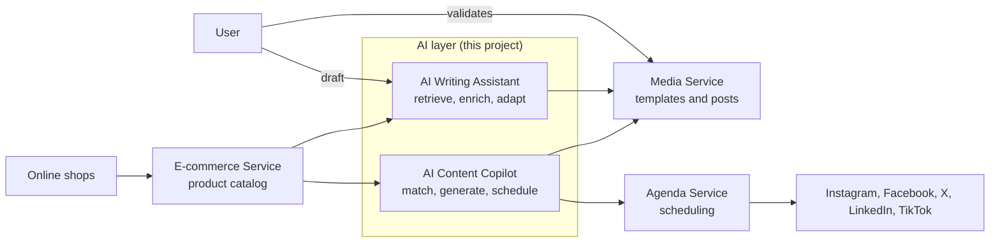

# LLM Pipeline for Social Media Automation

**Two AI systems that turn product catalogs and rough drafts into platform-ready social media posts, built with open-source LLMs, semantic retrieval and parameter-efficient fine-tuning, on free-tier compute.**

Final-year engineering project (PFE) · Data Science track · Faculty of Sciences of Tunis, University of Tunis El Manar · Carried out at Audasoft Technology within the Sociaboost platform · Defended October 2025

[Full report (PDF)](docs/PFE_Report_Social_Content_Automation.pdf) · [Architecture](docs/architecture.md) · [Portfolio](https://bouzidimariam.github.io/projects.html)

> **About this repository.** It contains documentation only: the project overview, the architecture and design decisions, and the full final-year report. It contains no source code.

---

## The problem

Small and medium e-commerce businesses juggle several disconnected tools to write posts, schedule them and keep product information consistent. Existing automation mostly offers generic templates: captions that are correct but indistinguishable from competitors', and that ignore product details, brand voice and platform conventions.

## The solution

Sociaboost is an all-in-one marketing and e-commerce platform. My project built its AI layer, made of two complementary modules:

| Module | Input | Output |
|---|---|---|
| **AI Content Copilot** | A product from the catalog | A ready-to-publish post, matched to the best template, adapted to the platform and scheduled |
| **AI Writing Assistant** | A rough draft written by the user | The same draft enriched with real product data and adapted to the target platform |

Both modules support French and English, and both keep the user in control: nothing is stored for publication before the user validates it.

## What I did

I designed, implemented and evaluated both systems end to end:

- Designed the AI architecture and its integration with the platform's e-commerce, media and agenda services
- Built the data foundation: a product crawler, a curated bilingual (FR/EN) set of templates and reference posts, and training datasets
- Fine-tuned open LLMs with QLoRA and LoRA for template ranking, post generation and product enrichment
- Built a semantic retrieval layer (sentence embeddings and a FAISS index) that links free-text drafts to catalog products
- Orchestrated the pipelines as LangGraph workflows with fallback paths
- Evaluated the system at three levels: individual models, full pipelines, and simulated user feedback

## Architecture at a glance

The Copilot is a modular pipeline (crawl, preselect, rank, generate, schedule). The Assistant is a hybrid design: semantic retrieval followed by two specialised models that share context. Details and diagrams are in [docs/architecture.md](docs/architecture.md).

## Built under real constraints

The host company required exclusive use of free and open-source resources, and the AI had to plug into an existing Next.js and Go stack. That shaped every choice:

- **No paid APIs or cloud.** Open-source models with permissive licenses only.
- **Free GPUs.** Training on Kaggle T4 and P100 sessions, which meant 4-bit quantization and parameter-efficient fine-tuning instead of full training.
- **7B-class models.** Mistral 7B Instruct and Zephyr-7B, chosen for bilingual quality, license and ability to run on consumer-grade GPUs.
- **Interoperability.** Python AI services designed to sit beside a Go backend and a MongoDB data layer.

## Results

Reported in the project report, comparing zero-shot prompting, few-shot prompting and fine-tuning combined with prompting.

| Component | Metric | Zero-shot | Few-shot | Fine-tuned + prompting |
|---|---|---|---|---|
| Template matching | nDCG@5 | 0.19 | 0.40 | **0.75** |
| Template matching | Precision@1 | 0.15 | 0.30 | **0.68** |
| Post generation | BERTScore | 0.63 | 0.71 | **0.82** |
| Post generation | ROUGE-L | 0.68 | 0.84 | **0.90** |

Other results: product retrieval reached **96% Recall@1** at about 400 ms average latency, and the Assistant pipeline completed over 80% of runs end to end, with fallbacks for retrieval failures.

**How to read these numbers.** They come from small, curated datasets and from a simulated feedback proxy, not from live users. The report states this limitation and lists real-world testing and A/B evaluation as the next step. The consistent finding is the relative one: fine-tuning clearly beats prompting alone on both ranking and generation.

## Tech stack

| Area | Technologies |
|---|---|
| LLMs | Mistral 7B Instruct, Zephyr-7B-beta |
| Fine-tuning | QLoRA and LoRA, Hugging Face Transformers, PEFT, TRL, bitsandbytes |
| Retrieval | all-MiniLM-L6-v2 sentence embeddings, FAISS |
| Orchestration | LangGraph |
| Data | MongoDB (operational), Hugging Face Datasets (training) |
| Training and hosting | Kaggle notebooks, Hugging Face Hub |
| Prototyping and integration | Streamlit, Flask, Go (product crawler) |
| Evaluation | nDCG, MRR, Precision@k, BLEU, ROUGE-L, BERTScore, Recall@k |

## Documentation

| Document | What it covers |
|---|---|
| [Architecture](docs/architecture.md) | System context, the two pipelines, orchestration, data, design decisions and trade-offs, evaluation, limitations |
| [Full report](docs/PFE_Report_Social_Content_Automation.pdf) | The complete final-year project report |

## Scope of this repository

**Included:** overview, architecture and design documentation, and the final-year report.

**Not included:** source code. The platform belongs to the host company.
