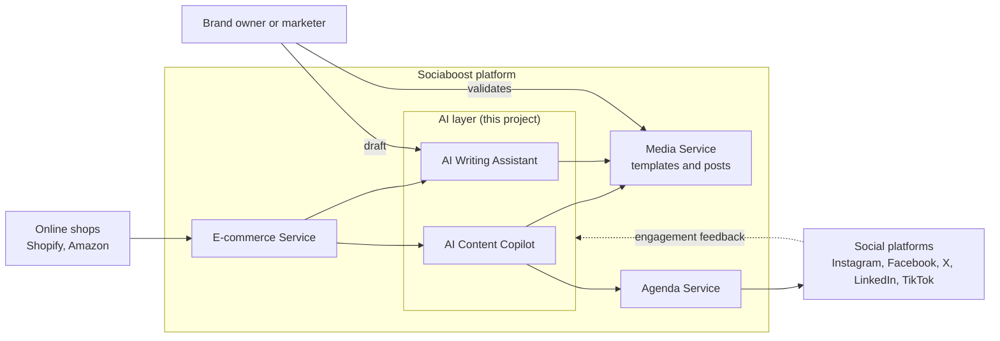
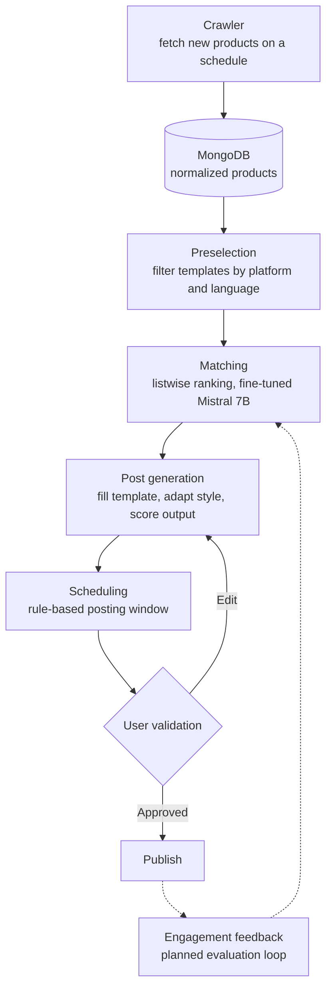
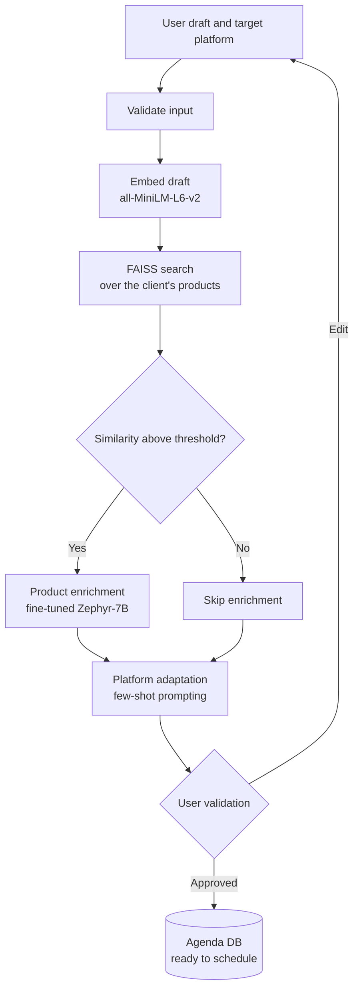

# Architecture

This document describes the architecture of the AI layer built for the Sociaboost platform: the two pipelines, how they are orchestrated, how data and models are managed under tight resource limits, and the reasoning behind the main design decisions.

> **Scope.** This is design documentation. For the full theory, annexes and detailed tables, see the [final-year report](PFE_Report_Social_Content_Automation.pdf).

---

## 1. Context

Sociaboost is a modular platform that combines e-commerce and social media management. The AI layer plugs into three of its services:

| Service | Role in the AI layer |
|---|---|
| **E-commerce Service** | Data foundation: product names, descriptions, categories, prices, stock |
| **Media Service** | Where posts and templates live; both AI modules write their output here |
| **Agenda Service** | Where posts are scheduled for publication |

The two modules run independently on the same infrastructure. The Copilot works proactively from the catalog; the Assistant is invoked by the user when a draft needs improving. In both cases the user validates the result before anything is stored for publication.

## 2. Constraints

Three constraints framed every technical decision.

| Constraint | Consequence |
|---|---|
| **Financial.** Free and open-source resources only | No commercial APIs, cloud or licensed software. Open models with permissive licenses, free-tier training. |
| **Computational.** LLM work on free GPUs | Kaggle T4 and P100 sessions with usage limits, so 4-bit quantization, parameter-efficient fine-tuning and incremental training. |
| **Architectural.** Must fit an existing Next.js, React and Go ecosystem | AI exposed as Python services that interoperate with a Go backend and MongoDB. |

## 3. AI Content Copilot

The Copilot turns a catalog product into a scheduled post. It follows a **layered architecture** (application, backend API, AI models core, data) and a **modular pipeline** inside its models core.

| Stage | What it does | How |
|---|---|---|
| **Crawler** | Keeps each client's catalog fresh | Configurable by frequency, mode (scheduled, recurring, on demand) and data type; products stored in a normalized schema |
| **Preselection** | Shrinks the template pool cheaply | Deterministic filter on platform and language, with a default pool of generic templates if nothing matches |
| **Matching** | Ranks the remaining templates for the product | Framed as a listwise learning-to-rank task; Mistral 7B Instruct fine-tuned with QLoRA on a listwise ranking objective, with few-shot prompting at inference |
| **Generation** | Produces the final post | Fills placeholders from product data and adapts tone and format to the platform; fine-tuned with LoRA; returns a fixed schema (text, score, confidence breakdown) so outputs can be evaluated |
| **Scheduling** | Chooses when to publish | Rule engine mapping (category, platform) to posting windows, with platform defaults as fallback |

The evaluation loop shown with dotted lines is part of the design, to adjust template rankings from engagement data once real usage data exists.

## 4. AI Writing Assistant

The Assistant takes a user's draft and a target platform and returns an improved post. It uses a **hybrid design**: semantic retrieval first, then two specialised models running in sequence on shared context.

| Stage | What it does | How |
|---|---|---|
| **Mention detection and retrieval** | Finds the products a draft talks about, even implicitly ("our new silver watch") | Drafts and product records (name plus description) embedded in one semantic space, searched with a FAISS index; matches below a similarity threshold are discarded |
| **Product enrichment** | Grounds the draft in real catalog facts | Zephyr-7B fine-tuned with LoRA on 4-bit weights; prompt includes retrieved product metadata |
| **Platform adaptation** | Adjusts tone, length, hashtags and emojis | Instruction-tuned model with few-shot examples per platform; no extra fine-tuning needed |
| **Validation and storage** | Keeps the human in control | User reviews and edits; the final post is stored for scheduling |

If no product is detected, the pipeline does not fail: it skips enrichment and still adapts the draft to the platform.

## 5. Orchestration

Both pipelines are implemented as **LangGraph** graphs. Each step is a node, data flow is explicit, and conditional edges handle branching and fallbacks.

- **Copilot graph:** matching subgraph (normalize inputs, preselect, rank), post generation subgraph, scheduling node.
- **Assistant graph:** input parsing, retrieval node, product-enrichment subgraph, platform-enhancement subgraph.
- **Why a graph and not scripts:** explicit dependencies, reusable nodes, conditional execution, traceability of every intermediate state, and room to add nodes without reworking the pipeline.

## 6. Data and storage

| Store | Purpose |
|---|---|
| **MongoDB** (operational) | Products, raw crawler data, Copilot posts, Assistant posts, templates. Posts reference product and template IDs, so every output can be traced back to its inputs. |
| **Hugging Face Datasets** (training) | Frozen, versioned snapshots used for fine-tuning and evaluation. |
| **Hugging Face Hub** | Model hosting and versioning (merged, quantized adapter weights). |

Datasets built for the project: products, templates, template-product-post triplets (post generation), user post-product-enhanced post triplets (enrichment) and post-platform-enhanced post pairs (platform adaptation). Data covers French and English, because tone and persuasion conventions differ between the two languages.

## 7. Training under limited compute

- **Base models:** Mistral 7B Instruct (Apache-2.0) and Zephyr-7B-beta.
- **Method:** QLoRA with 4-bit quantization for the ranking model; LoRA adapters on attention projections for generation and enrichment.
- **Tooling:** Hugging Face Transformers, PEFT, TRL and bitsandbytes, with mixed precision and gradient accumulation.
- **Hardware:** Kaggle T4 (single and dual) and P100 notebooks.
- **Release:** adapters merged into the base model, quantized and published to the Hugging Face Hub.
- **Inference footprint:** peak GPU memory of about 6.75 GB for a Copilot run, within the reach of consumer GPUs.

## 8. Design decisions and trade-offs

| Decision | Alternatives considered | Why this choice | Cost accepted |
|---|---|---|---|
| **Copilot: modular pipeline** | Single end-to-end LLM | Matching, generation and scheduling are different tasks; each can be inspected, evaluated and swapped independently | More inference steps and integration work |
| **Assistant: hybrid of two sequential models** | One unified model; two fully independent models | Specialisation for facts and for style while keeping a shared context | Slightly more complex data flow |
| **Mistral 7B Instruct as the main model** | Falcon 7B, LLaMA 2, Qwen 2.5, Mixtral, very large models | Best balance of bilingual quality, license (Apache-2.0) and ability to run on small GPUs | Less raw capability than much larger models |
| **Fine-tuning on top of prompting** | Prompting only | Prompting alone was unstable on subtle distinctions and inconsistent on attributes and style | Dataset building effort and GPU time |
| **QLoRA and LoRA** | Full fine-tuning | Only feasible way to adapt 7B models on free GPUs | Limited adapter capacity |
| **MiniLM embeddings and FAISS** | Larger embedding models, managed vector databases | Lightweight, fast, no paid service, easy to run alongside the models | Retrieval is in-process; a managed vector store would suit larger catalogs |
| **MongoDB** | PostgreSQL, MySQL, Firebase | Document model suits heterogeneous product and post data and integrates easily with Python | Weaker relational querying |
| **Rule-based scheduling (phase 1)** | Predictive ML model | Deterministic, explainable, and no engagement data was available yet | Rules cover a limited set of category-platform pairs |
| **Kaggle for training** | Google Colab | More stable sessions, more RAM, native dataset integration | Daily quotas |
| **Hugging Face Hub for models** | GitHub | Built for large model files, with model cards and demo support | Another platform to manage |
| **LangGraph** | Linear scripts, heavier frameworks | Explicit, lightweight, conditional workflows | A new abstraction for the team to learn |
| **Human validation before storage** | Fully automatic publishing | Brand safety and user trust | Not fully hands-off |

## 9. Evaluation

Evaluation is layered so that failures can be located precisely.

1. **Model level:** each component compared in three configurations (zero-shot, few-shot, fine-tuned plus few-shot prompting).
2. **System level:** the full LangGraph pipelines, looking at orchestration, robustness and resource use.
3. **User-oriented:** a simulated feedback proxy that combines rule-based heuristics and neural preference models into quality, relevance and platform-fit scores.

| Component | Metric | Zero-shot | Few-shot | Fine-tuned + prompting |
|---|---|---|---|---|
| Template matching | nDCG@5 | 0.19 | 0.40 | 0.75 |
| Template matching | MRR | 0.20 | 0.38 | 0.72 |
| Template matching | Precision@1 | 0.15 | 0.30 | 0.68 |
| Post generation | BLEU | 0.45 | 0.67 | 0.79 |
| Post generation | ROUGE-L | 0.68 | 0.84 | 0.90 |
| Post generation | BERTScore | 0.63 | 0.71 | 0.82 |

- **Retrieval:** Recall@1 of 96% at about 400 ms average latency; underspecified drafts fall back safely to platform adaptation.
- **Pipelines:** the Assistant completes over 80% of runs end to end; the Copilot's end-to-end rate was lower, mainly because scheduling rules did not cover every category-platform pair.
- **Proxy feedback:** aggregated scores of 0.82 (Copilot) and 0.83 (Assistant), with the Copilot stronger on style and the Assistant stronger on factual relevance.

**Caveats.** Datasets are small and curated, the user-oriented evaluation is simulated, and scheduling was assessed on operational criteria only because no engagement data existed. These results show the relative value of fine-tuning and a working architecture; they are not a claim of production-level performance.

## 10. Limitations and next steps

- **Real data.** Pilot the platform with real clients to collect authentic products, posts and engagement, then retrain.
- **Evaluation.** Replace the proxy with A/B tests and crowd-sourced preference studies.
- **Scheduling.** Move from rules to models that predict posting times once engagement data is available, and widen rule coverage.
- **Retrieval.** Add a vector database with caching and asynchronous retrieval to cut latency on large catalogs.
- **Models.** Explore stronger models, including hybrid use of open and commercial models, to balance cost and quality.
- **Retraining.** Move from static dataset snapshots to a semi-dynamic loop: incremental exports from MongoDB, automatic dataset versioning, and periodic fine-tuning.
- **Production.** Move from notebooks and prototypes to containerized, GPU-enabled services with monitoring.

## 11. Related documents

- [Final-year project report](PFE_Report_Social_Content_Automation.pdf)
- [Back to the README](../README.md)
